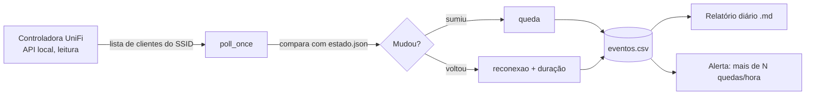

# Monitor de quedas Wi-Fi de coletores (WMS)

[](https://github.com/pereirashouse/monitoramentowificompython/actions/workflows/testes.yml)


[](LICENSE)

Ferramenta em Python que mede, de forma objetiva, as quedas de Wi-Fi dos coletores de dados de um centro de distribuição. Ela consulta a controladora UniFi em modo somente leitura, registra cada queda e reconexão com AP, sinal e banda, e gera um relatório diário em Markdown.

## Problema

Em um centro de distribuição, os operadores usam coletores Android (Urovo, Skorpio) conectados ao Wi-Fi para trabalhar no WMS (Warehouse Management System). Quando o coletor perde a rede, a sessão no sistema cai e o operador precisa refazer o login, o que atrasa a separação e a expedição.

As reclamações chegavam como "o coletor caiu de novo", sem horário, sem identificação do aparelho e sem a antena em que ele estava. Sem esses dados não era possível saber se o problema era de cobertura, de uma AP específica, de um modelo de coletor ou de um horário de pico.

## Objetivo

- Registrar automaticamente cada queda e cada reconexão dos coletores do SSID operacional.
- Guardar junto de cada evento a AP, o sinal (dBm), a relação sinal-ruído e a banda usada.
- Destacar os coletores que caem mais de N vezes na mesma hora.
- Produzir um relatório diário que possa ser usado para decidir ajustes de rádio (canal, potência, posição de AP) e comparar o antes e o depois.
- Fazer tudo isso sem alterar nada na controladora e sem instalar bibliotecas.

## O que eu desenvolvi

- **Coleta somente leitura** na API local do UniFi, com a chave lida de variável de ambiente (nunca de arquivo).
- **Detecção de transições** comparando a lista atual de clientes com o estado anterior: `primeira_vez`, `queda` e `reconexao`, com a duração da queda em segundos.
- **Classificação dos aparelhos** por inventário, por prefixo de fabricante (OUI) ou por nome, incluindo Android com MAC aleatório.
- **Log em CSV** (`eventos.csv`) com uma linha por evento, fácil de abrir no Excel ou cruzar com os logs da controladora.
- **Relatório diário em Markdown** com quedas por tipo, coletores mais afetados e alertas.
- **Alertas sem repetição** no modo contínuo: o mesmo alerta (MAC + hora) aparece uma vez só por dia.
- **TLS seguro por padrão**, com validação de certificado e hostname, suporte a CA interna e sem fallback automático para conexão insegura.
- **Demonstração sem controladora** (`exemplos/demonstracao.py`) e **testes automatizados** de coleta, eventos, relatórios e TLS, executados pelo GitHub Actions em Python 3.10 a 3.13.



## Demonstração

Dá para ver o monitor funcionando sem ter uma controladora UniFi. O script abaixo simula nove ciclos de coleta de um turno, com três coletores fictícios:

```bash
python exemplos/demonstracao.py
```

Um exemplo de relatório gerado com dados reais e sanitizados (MACs trocados por pseudônimos, antenas com nomes genéricos) está em [`exemplos/relatorio_exemplo.md`](exemplos/relatorio_exemplo.md). Ele cobre seis dias, 37 quedas e 4 antenas.

## Tecnologias

| Item | Uso |
|---|---|
| Python 3.10+ (só biblioteca padrão) | `urllib`, `ssl`, `csv`, `json`, `datetime` |
| API local do UniFi Network | Lista de clientes conectados (`/stat/sta`) |
| CSV e Markdown | Log de eventos e relatório diário |
| `unittest` + `unittest.mock` | Testes com a API simulada |
| GitHub Actions | Testes a cada push e pull request |

Testado com UniFi Network 10.6 em um UCK G2 Plus.

## Como executar

### 1. Preparar

```bash
git clone https://github.com/pereirashouse/monitoramentowificompython.git
cd monitoramentowificompython
cp config.example.json config.json
# Edite config.json com os valores do seu ambiente
```

Defina a chave de API, gerada na aplicação Network com permissão **somente leitura**:

```bash
# Linux / macOS
export UNIFI_API_KEY="sua-chave"

# Windows PowerShell (persiste após reiniciar)
setx UNIFI_API_KEY "sua-chave"
# Feche e reabra o terminal
```

### 2. Configurar

| Campo | Descrição |
|---|---|
| `controller_host` | Endereço da controladora, sem `https://`, ex.: `192.168.1.1` |
| `clients_path` | Caminho da API legada. Veja **Descobrindo o site_id** abaixo. |
| `ssid` | SSID dos coletores (espaços nas pontas são ignorados) |
| `verify_tls` | Booleano JSON; padrão `true`. Valida certificado e hostname. `false` desativa ambas as verificações e emite aviso de risco; somente para diagnóstico temporário em laboratório isolado. |
| `ca_file` | Opcional: caminho de um arquivo PEM com a CA confiável. `null`, vazio ou omitido usa as CAs padrão carregadas pelo Python. Caminho relativo é resolvido a partir do diretório de execução; prefira caminho absoluto. |
| `poll_seconds` | Intervalo do modo `loop`, em segundos (padrão: 60) |
| `alert_drops_per_hour` | Alerta quando o mesmo MAC passa desse número de quedas na hora (padrão: 3) |
| `collector_macs` | Inventário opcional: `"mac": "Modelo"` |
| `ap_names` | Opcional: `"mac_da_ap": "Nome"`, já que a API legada não envia o nome da AP |
| `state_dir` | Opcional: pasta dos dados (padrão: `dados/` ao lado do script) |

Para usar outro arquivo de configuração, defina a variável `COLETORES_CONFIG` com o caminho dele.

**Certificados e CA interna**

O exemplo agora usa `verify_tls: true`. Isso também é o padrão quando o campo é omitido. Use `true` e `false` sem aspas: valores como `"false"`, `0` ou `null` são rejeitados para evitar configuração ambígua. `ca_file` deve ser `null` ou uma string; booleanos, números, listas e objetos são rejeitados, mesmo no modo de laboratório.

Se a controladora tiver certificado assinado por uma CA já confiável para o Python, mantenha `ca_file: null`. Para uma CA interna, obtenha o certificado público da CA com o administrador por um canal confiável e confira sua impressão digital por um canal independente antes de utilizá-lo. Não publique chaves privadas nem copie como confiável um certificado obtido de uma conexão não autenticada.

Edite os campos abaixo em `config.json`, preservando os demais:

```json
{
  "controller_host": "unifi.exemplo.interno",
  "verify_tls": true,
  "ca_file": "/caminho/absoluto/ca-interna.pem"
}
```

No Windows, um caminho JSON pode usar barras normais, por exemplo `"C:/certificados/ca-interna.pem"`. O arquivo deve conter certificado(s) PEM, sem chave privada. Se o servidor usar certificado autoassinado, prefira substituí-lo por um certificado emitido por uma CA confiável. Caso seja necessário confiar explicitamente naquele certificado, confirme sua autenticidade e forneça seu PEM em `ca_file`, desde que seja compatível com a validação do Python/OpenSSL. Confiar no emissor não dispensa a correspondência do hostname ou IP em `controller_host` com o SAN do certificado.

Um erro `CERTIFICATE_VERIFY_FAILED` deve ser investigado: confira CA/cadeia, validade, relógio e hostname. Se `ca_file` apontar para um arquivo inexistente ou um PEM inválido, a coleta falha sem recorrer às CAs padrão. Omitir o campo ou usar `null`/string vazia é permitido e usa as CAs padrão; nesse caso, o certificado do servidor precisa ser confiável por elas. O monitor **não** tenta novamente com a verificação desligada e **não** registra uma falha TLS como queda de todos os coletores. No modo `loop`, informa a falha e aguarda o próximo ciclo com a mesma política TLS.

`verify_tls: false` permanece apenas para compatibilidade e diagnóstico temporário em laboratório isolado. Essa opção desativa a autenticação do servidor, não apenas a rejeição de certificados autoassinados, pode expor a chave de API a interceptação e ignora `ca_file`. O monitor emite um `RuntimeWarning` explícito. Não use essa opção em produção nem suprima o aviso para contornar um erro de certificado. Configurações antigas não são reescritas automaticamente: se seu `config.json` já contém `false`, ajuste-o manualmente e configure a CA antes de coletar.

**Descobrindo o site_id**

```bash
curl --fail --silent --show-error -H "X-API-KEY: $UNIFI_API_KEY" \
  https://SEU_CONTROLLER/proxy/network/integration/v1/sites | python3 -m json.tool
```

Para CA interna, acrescente `--cacert /caminho/absoluto/ca-interna.pem` ao comando `curl`. Use um hostname ou IP presente no certificado; não acrescente `-k` ou `--insecure` para contornar uma falha.

Procure o campo `internalReference` do seu site e substitua em `clients_path`:
`/proxy/network/api/s/SEU_SITE_ID/stat/sta`

### 3. Rodar

```bash
# Uma coleta imediata
python coletores_wifi_monitor.py poll

# Loop contínuo (uma coleta por minuto)
python coletores_wifi_monitor.py loop

# Relatório do dia atual
python coletores_wifi_monitor.py report

# Relatório de uma data específica
python coletores_wifi_monitor.py report 2026-10-15
```

### 4. Testar

```bash
python -m unittest discover -v
```

Os testes não acessam a controladora: a API é simulada. A suíte TLS verifica o padrão seguro, o uso de CA, a rejeição de opções ambíguas, o aviso no modo inseguro e a propagação de erros sem fallback. Os contextos SSL são inspecionados, mas a suíte não substitui uma validação ponta a ponta contra o certificado da sua controladora.

## Exemplo de uso

Cenário fictício: um Urovo na antena "Expedição - 1" com sinal fraco (-71 dBm) cai quatro vezes entre 22h e 22h30. Um Android com MAC aleatório cai uma vez. Um Skorpio na 5 GHz com sinal bom não cai.

**Eventos registrados** (saída de `python exemplos/demonstracao.py`, uma linha por evento do `eventos.csv`):

```text
2026-10-20T22:00:00  primeira_vez b4:29:3d:00:00:01  Urovo DT40                 Expedição - 1      -71 dBm
2026-10-20T22:00:00  primeira_vez 04:7b:cb:00:00:02  Skorpio X5                 Expedição - 5      -52 dBm
2026-10-20T22:00:00  primeira_vez 9e:0d:5e:00:00:03  Android (MAC aleatório)    Administração - 1  -49 dBm
2026-10-20T22:01:00  queda        b4:29:3d:00:00:01  Urovo DT40                 Expedição - 1      -71 dBm
2026-10-20T22:02:00  reconexao    b4:29:3d:00:00:01  Urovo DT40                 Expedição - 1      -71 dBm (60 s)
2026-10-20T22:10:00  queda        b4:29:3d:00:00:01  Urovo DT40                 Expedição - 1      -71 dBm
2026-10-20T22:11:00  reconexao    b4:29:3d:00:00:01  Urovo DT40                 Expedição - 1      -71 dBm (60 s)
2026-10-20T22:20:00  queda        b4:29:3d:00:00:01  Urovo DT40                 Expedição - 1      -71 dBm
2026-10-20T22:21:00  reconexao    b4:29:3d:00:00:01  Urovo DT40                 Expedição - 1      -71 dBm (60 s)
2026-10-20T22:30:00  queda        b4:29:3d:00:00:01  Urovo DT40                 Expedição - 1      -71 dBm
2026-10-20T22:30:00  queda        9e:0d:5e:00:00:03  Android (MAC aleatório)    Administração - 1  -49 dBm
2026-10-20T22:31:00  reconexao    b4:29:3d:00:00:01  Urovo DT40                 Expedição - 1      -71 dBm (60 s)
2026-10-20T22:31:00  reconexao    9e:0d:5e:00:00:03  Android (MAC aleatório)    Administração - 1  -49 dBm (60 s)
```

**Relatório do dia** (`dados/relatorio_2026-10-20.md`):

```markdown
# Relatório de quedas dos coletores (SSID wms) - 2026-10-20

- Quedas no dia: **5**
- Coletores com queda: **2**

## Quedas por tipo

| Tipo | Quedas |
|---|---|
| Urovo DT40 | 4 |
| Android (MAC aleatório) | 1 |

## Coletores mais afetados (top 10)

| MAC | Nome | Tipo | Quedas |
|---|---|---|---|
| b4:29:3d:00:00:01 |  | Urovo DT40 | 4 |
| 9e:0d:5e:00:00:03 | android-a1b2 | Android (MAC aleatório) | 1 |

## Alertas (mais de 3 quedas por hora)

- b4:29:3d:00:00:01 às 22h: 4 quedas
```

**Como ler:** o alerta aponta um aparelho e uma antena. Com o sinal de -71 dBm na 2,4 GHz, a hipótese a investigar primeiro é cobertura naquele ponto (posição ou potência da AP, ou o coletor preso em uma AP distante), e não um problema geral da rede.

### Saídas

| Arquivo | Descrição |
|---|---|
| `dados/estado.json` | Estado atual dos coletores (interno) |
| `dados/eventos.csv` | Log de todos os eventos (queda, reconexão) com timestamp, AP, sinal e banda |
| `dados/alertas_emitidos.json` | Alertas já mostrados no dia, para o modo `loop` não repetir o mesmo alerta |
| `dados/relatorio_AAAA-MM-DD.md` | Relatório diário com top coletores afetados, quedas por hora e alertas |

<details>
<summary>Colunas do <code>eventos.csv</code></summary>

| Coluna | Descrição |
|---|---|
| `timestamp` | ISO 8601 (AAAA-MM-DDTHH:MM:SS) |
| `mac` | MAC do coletor |
| `tipo` | Modelo do inventário, Urovo, Skorpio X5, Android (MAC aleatório) ou Desconhecido |
| `origem_id` | Como o tipo foi identificado: `inventario`, `fabricante`, `nome` ou `nenhuma` |
| `nome` | Nome ou hostname informado pela controladora |
| `evento` | `queda`, `reconexao` ou `primeira_vez` |
| `ap` | Nome da AP (pela API ou por `ap_names`) ou, na falta dele, o MAC da AP |
| `rssi_dbm` | Potência recebida em dBm (campo `signal` da API) |
| `snr` | Relação sinal-ruído (campo `rssi` da API legada) |
| `banda` | Rádio usado (`ng` = 2,4 GHz, `na` = 5 GHz) |
| `duracao_s` | Duração da queda em segundos (vazio na linha de queda; preenchido na reconexão) |

Se o `eventos.csv` existente estiver no formato antigo, ele é renomeado para `eventos_legado_<data>.csv` e um novo arquivo é iniciado.

</details>

<details>
<summary>Classificação automática dos aparelhos</summary>

| Prefixo | Modelo |
|---|---|
| `b4:29:3d` | Urovo |
| `04:7b:cb` | Skorpio X5 |
| `3c:e1:a1` | Skorpio X5 |

Dispositivos com MAC aleatório (bit "localmente administrado" ligado) e nome começando em `android` são identificados como Android com MAC aleatório. Adicione MACs individuais ao inventário em `config.json` para identificação precisa.

</details>

## Limitações

- **Amostragem por polling.** Com coleta a cada 60 s, quedas mais curtas que o intervalo podem passar despercebidas, e a duração medida tem a precisão do intervalo. Para rastreamento exato, use os logs de eventos do UniFi em paralelo.
- **Lacunas do próprio monitor.** Se o script parar (máquina desligada, falha de rede até a controladora), a próxima reconexão aparece com uma duração enorme. No relatório de exemplo, essas quedas estão marcadas como "possível lacuna".
- **Início a frio.** Coletores já offline quando o monitor inicia não geram evento de queda; só a reconexão é registrada.
- **API não documentada.** A API legada (`/stat/sta`) não é documentada oficialmente pela Ubiquiti e pode mudar em versões futuras.
- **Só UniFi.** Outras controladoras (Aruba, Omada, Cisco) precisariam de um novo `unifi_get_clients`.
- **Queda não é causa.** O monitor mostra quando, onde e com que sinal o coletor caiu. A causa (roaming, interferência, economia de energia do Android, sessão do WMS) ainda precisa ser confirmada com outras fontes.
- **TLS.** Certificados autoassinados ou de CA interna exigem configuração de confiança explícita e hostname/IP compatível. O monitor falha sem reduzir a segurança; um laboratório validado não comprova funcionamento em outras controladoras.

## Próximos passos

- Incluir no relatório o resumo por AP e por banda (hoje só no relatório de exemplo), para apontar a antena problemática direto.
- Registrar os eventos de roaming (troca de AP sem queda) para separar roaming lento de perda real de sinal.
- Ler também métricas da AP no momento da queda (TX Retry, Channel Utilization) para correlacionar com interferência.
- Exportar para Prometheus ou Zabbix e acompanhar a tendência em um painel.
- Rodar como serviço (systemd no Linux, Agendador de Tarefas no Windows) com rotação do CSV.
- Adaptador para outras controladoras.

## Segurança

- Nunca grave a chave de API em arquivo, código ou histórico de shell.
- Chave exposta: revogue imediatamente na aplicação Network e gere outra.
- O agente faz apenas leituras; não altera configuração da controladora.
- Não execute como root ou administrador.
- Mantenha `verify_tls: true`; proteja a integridade do arquivo de CA e renove certificados antes de expirarem.

## Licença

[MIT](LICENSE)
